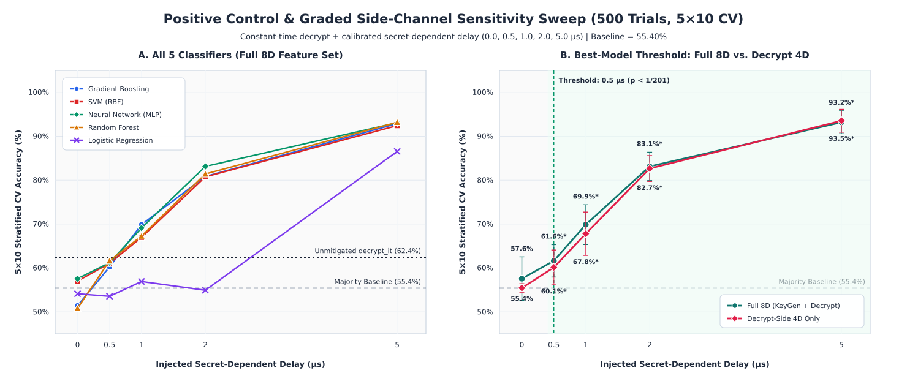
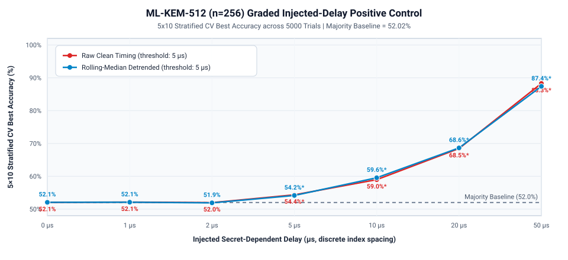
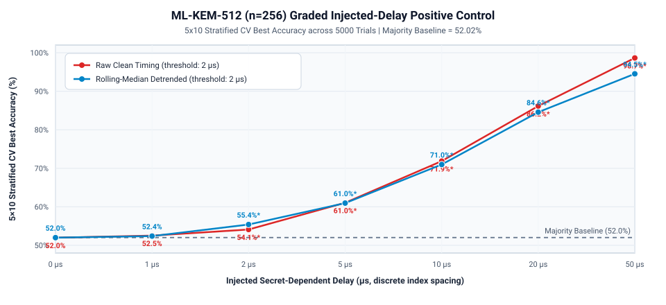

# ML & Side-Channel Leakage Evaluation of Post-Quantum Key Exchange (QEQSKE)

Empirical security evaluation of HCL Software's **QEQSKE** (*Quantum-Enabled Quantum-Safe Key Exchange*, Ghosh et al.) as a representative post-quantum key-exchange protocol using statistical randomness testing, machine-learning distinguishers, and software-observable side-channel analysis.

- **Course:** CSD493 Final-Year Capstone Project, Shiv Nadar University
- **Faculty Supervisor:** Prof. Rajib Mall
- **Industry Partner:** HCL Software
- **Team:** Sri Surya Srikar, Sashreek Kandagatla, Sane Yateesh Reddy
- **Dataset:** 1,106,944 quantum random numbers from the Australian National University (ANU) QRNG API (`qrng_combined.txt`, uint16 stream)

---

## 1. Executive Headline & What This Project Claims

The empirical evidence across `results/` cleanly separates **receiver-side decapsulation (`decrypt_it`)** (a genuine, mechanistically verified CPython timing side-channel) from **public channel / randomness handling** (no ML leakage detected), and separates **uninstrumented execution** from **`tracemalloc` instrumentation artifacts**:

> **Primary Finding (5,000-Trial Uninstrumented Evaluation, `results/decrypt_leak_5000_linux_i9_recollect_summary.md`, `results/decrypt_leak_5000_linux_i9_seed1337_summary.md`, `results/decrypt_leak_5000_mac_arm64_summary.md`, and `results/decrypt_leak_5000_summary.md`):**
> Under a clean, uninstrumented software timing threat model at toy parameters (`n=4, k=2`, `5,000` QRNG trials), unmodified `decrypt_it()` leaks `secret_weight` across two physical architectures and across fresh key seeds:
> - **Same-seed (`seed=42`, `53.70%` baseline — tests the machine/runtime on fixed keys):** On **Linux `i9-12900K`** (fresh runtime-captured run, `results/decrypt_leak_5000_linux_i9_recollect.json`), binary accuracy reaches **65.78% ± 1.51%** (`SVM (RBF)`, `AUC 0.7096`, shuffled `53.86%`, `+11.92` pt net gap, `q`-resid `66.16%`, `p < 1/201 (0.0050)`), regression **R² = +0.2127** (`MLP`), and timing Spearman **`ρ = +0.4237`** (`CPU ρ = +0.4060`). The earlier Linux run (`results/decrypt_leak_5000.json`, *environment inferred, not captured at run time*) measured **65.25% ± 1.49%** (`MLP`, `AUC 0.7076`, `R² = +0.2260` `SVR`, `ρ = +0.4166`). On **macOS `Apple M2`** (`results/decrypt_leak_5000_mac_arm64.json`), the same keys yield **63.65% ± 1.30%** (`Gradient Boosting`, `AUC 0.6798`, `R² = +0.1768` `MLP`, `ρ = +0.3418` timing / `+0.3706` CPU).
> - **Fresh key sampling (`seed=1337`, `qrng_start_offset = 795,881`, `51.54%` baseline — tests fresh keys, `results/decrypt_leak_5000_linux_i9_seed1337.json`):** Reproduces cleanly at **65.92% ± 1.44%** (`MLP`, `AUC 0.7063`, shuffled `52.18%`, `+13.74` pt net gap, `+14.38` pts over baseline, `p < 1/201`), **R² = +0.2070** (`MLP`), and Spearman **`ρ = +0.4099`** timing / `+0.3914` CPU.

> **End-to-End Clean Sender ↔ Receiver & TCP Socket RTT (`results/stress_test_traces_5000_summary.md`):**
> On `5,000` clean uninstrumented Alice ↔ Bob exchanges (`Apple M2`, `results/stress_test_traces_5000.json`), **Sender (`encrypt_it`)** remains strictly at baseline (`53.68%`, `p = 0.3682`), **Receiver (`decrypt_it`)** leaks locally at **`65.29% ± 0.90%`** (`SVM (RBF)`, `p < 1/201`), and routing decryption over a **live localhost TCP socket (`127.0.0.1`)** attenuates that leak via socket/JSON jitter (`IQR 34.50 µs` vs. `3.08 µs` local) down to a faint **`55.67% ± 0.98%`** (`MLP`, `ρ = +0.0700`, `p < 1/201`), which disappears completely under `decrypt_it_constant_time` (`53.92%`, `ρ = -0.0033`, `p = 0.0995`). Meanwhile, **Public Channel (`u, v`)** summaries stay near baseline (**`55.59%`** vs. `53.70%` baseline, `p < 1/201`), revealing a minor (`+1.89` pt) toy-`n=4` effect driven chiefly by `119/5,000` (`2.38%`) keys with an all-zero column in `s` (`results/tier1c_zero_column_analysis.json`).

> **Observer Effect (`tracemalloc` Amplifies the Leak):**
> Wrapping `decrypt_it()` inside Python's `tracemalloc.start()/stop()` — as done in earlier 500-trial collectors (`results/stress_test_traces.json`, `attack_c_decrypt_sidechannel.py`) — slows decryption **`~11.6–11.9×`** (`73.37 → 852.27 µs` in `results/decrypt_leak_5000_linux_i9_recollect.json`; `72.78 → 864.43 µs` in `results/decrypt_leak_5000_linux_i9_seed1337.json`; `75.21 → 882.02 µs` in `results/decrypt_leak_5000.json` [*environment inferred, not captured at run time*]) and **artificially amplifies** the side-channel signal: Spearman `ρ` jumps from **`+0.34–+0.42`** (`+0.41–+0.42` on Linux; `+0.3418` on Apple M2) to **`+0.8241–+0.8615`** (`+0.8302` in `results/decrypt_leak_5000_mac_arm64.json`), classification accuracy rises to **`84.01%`** (`SVM`, `linux_i9_recollect`) / **`86.33%`** (`LR`, `linux_i9_seed1337`) / **`84.37%`** (`GB`, `results/decrypt_leak_5000.json`) / **`85.21%`** (`LR`, `mac_arm64`), and regression `R²` (2-feat) rises to **`+0.6877–+0.7445`** (up to `+0.7724` with 4 features). The root cause is CPython's allocation hook intercepting every new `PyLongObject` produced by `x * (±1)` while skipping cached small-int `0` products (`x * 0`). Accordingly, all earlier 500-trial `~80–82%` figures (`results/stress_test_traces.json`, `results/attack_c_full_stats.json`) are explicitly marked **Legacy (`tracemalloc`-wrapped)** below.

> **Constant-Time Mitigation (`decrypt_it_constant_time`, `results/decrypt_ct_leak_5000_summary.md`):**
> Replacing pure-Python `mat_mult_mod` and conditional rounding branches with fixed-width vectorized NumPy `int64` arithmetic and bitwise selection eliminates the leak on the identical 5,000 QRNG trials (`results/decrypt_ct_leak_5000.json`): clean timing correlation drops to `ρ = -0.0258` (`p = 0.0677`), best classifier accuracy drops to **`53.56%`** (`p = 0.7065`, at `53.70%` majority baseline), and **all 5 regression models yield `R² < 0`** (no predictive skill).

> **Negative & Null Findings (No Exploitably Significant ML Leakage Detected):**
> Across the same evaluation methodology (repeated CV, shuffled-label control, and `q`-confound checks):
> 1. Raw ANU QRNG vs. Mersenne Twister (`attack_a_distinguisher.py`, `attack_a_sequence.py`, `results/attack_a_level1_full_stats.json` — `48.10–50.00%` accuracy).
> 2. **Sender (`encrypt_it`)** execution traces (`Tier 1a`, clean 5,000 trials in `results/stress_test_traces_5000.json`: `53.68%` vs. `53.70%` baseline, `p = 0.3682`; legacy 500 trials in `results/stress_test_traces.json`: `53.68%` vs. `55.40%` baseline).
> 3. **Public Channel** ciphertext statistical summaries (`Tier 1c`: legacy 500 trials `52.84%` in `results/stress_test_traces.json`; clean 5,000 trials `55.59%` vs. `53.70%` baseline in `results/stress_test_traces_5000.json` — only `+1.89` pts above baseline due to `n=4` sparse/zero-column key artifacts).
> 4. `key_gen()` under `tracemalloc` (`results/attack_c_full_stats.json` and the 5-level `results/attack_c_progressive_difficulty.json` ladder — all targets at or below majority baseline). *(Note: when measured uninstrumented with CPU core pinning in the extended positive control `results/attack_c_leaky_vs_clean.json`, `key_gen()` exhibits a subtle `+0.53 µs` shift from its single `mat_mult_mod(A, s, q)` call, `58.52%` MLP vs. `55.40%` baseline.)*
> 5. **Real ML-KEM-512 (`n=256, k=2, q=3329` via `kyber-py`) & QEQSKE Variant (per-key NTT `q`, QRNG-fed) Decapsulation (`attack_c_mlkem_decrypt_5000.py`):** Neither `secret_weight` nor individual coefficient sign `s[0][0]` leaks in clean `decaps`, isolated `_k_pke_decrypt`, or `tracemalloc` passes across both **`seed=42`** (`results/mlkem512_decrypt_leak_5000.json`: `52.12%` vs `52.02%`, `p = 0.1592`; `results/mlkem512_qeqske_decrypt_leak_5000.json`: `51.09%` vs `51.14%`, `p = 0.2438`) and **fresh-key `seed=1337`** (`results/mlkem512_linux_i9_seed1337_decrypt_leak_5000.json`: `51.89%` vs `51.68%`, `p = 0.1244`; `results/mlkem512_qeqske_linux_i9_seed1337_decrypt_leak_5000.json`: `52.52%` vs `51.94%`, `p = 0.0697`; all `R² < 0`). NTT transformation (`s_hat = NTT(s)`) eliminates coefficient-domain zero sparsity (`0.04–0.17 / 512` zeros in `s_hat` vs. `~160` zeros in `s`). On Linux `i9-12900K`, this null is calibrated against the **Linux `5.0 µs` detection floor** (`results/mlkem512_positive_control_5000_linux_i9.json`), rather than Apple M2's `2.0 µs` floor (`results/mlkem512_positive_control_5000.json`).

### Methodological Notes & Scope Boundaries
- **Permutation p-value convention (`< 1/(N+1)`):** With `N = 200` permutations in `permutation_test_score`, observing `0` permutations exceeding the real score hits the Phipson–Smyth resolution floor `1 / (N + 1) = 1/201 ≈ 0.004975` and is reported throughout as **`< 1/201 (0.0050)`** rather than an exact `0.0050`.
- **Negative-R² regression caveat:** Out-of-fold `R² <= 0` means a regressor performs *worse* than predicting the constant sample mean (`RMSE >= std(y) = 1.3320`). Negative-`R²` models (such as unpruned `Random Forest` on noisy clean timing, `R² = -0.0776`, and all 5 regressors on `decrypt_it_constant_time`) carry no valid continuous predictive skill and are explicitly caveated.
- **Not a proof of cryptographic security or LWE hardness:** At toy parameters `n=4, k=2`, the secret matrix is recoverable from public `(A, t)` in `<1 ms` (`break_poc.py` at `0.34 ms/key`, `attack_e_algebraic_lwe.py` at `0.18 ms/key`, `results/break_poc_and_algebraic_lwe.json`; note `attack_e_lll_lattice.py` is excluded from this `<1 ms` claim as plain LLL without Kannan embedding yields `0/200` recovery at `~92 ms/key`).
- **Software proxies, not hardware PMU/oscilloscope traces:** Timing (`perf_counter`), process CPU (`resource.getrusage` on Linux/macOS; legacy 500-trial scripts used `psutil`), and `tracemalloc` are software-level proxies.
- **Fault injection excluded:** Fault-injection attacks (Attack D) are intentionally out of scope (`attack_d_cca_mismatch.py` documents an unrelated missing Fujisaki–Okamoto check in the appendix).

---

## 2. Self-Audit: Two Cryptographic Breaks Found in Our Implementation

Run `python3 break_poc.py`:

1. **Break 1 — One-Time-Pad Reuse in `encrypt_it` (FIXED):**
   Earlier code sampled `r` and `e1` once per message and reused `res_v_1 = r*t + e1` across all ciphertext blocks `v_queue[i]`, so subtracting two blocks yielded `(bit_i - bit_j) * (q // 2)` and recovered the plaintext (up to global complement) with no key material. Fixed in `qeqske_core.py` by sampling fresh `r, e1, e2` per bit (`legacy_pad_reuse=False` default; `legacy_pad_reuse=True` preserved for reproduction).
2. **Break 2 — Brute-Forceable Secret at Toy Parameters `n=4, k=2` (INHERENT, NOT FIXED):**
   With `s` in `{-1, 0, 1}^{4×2}` and `q ~ 30,000`, each column has only `3^4 = 81` candidates and unit-bounded noise is negligible relative to `q`, enabling exact key recovery from `(A, t)` in `<1 ms` (`break_poc.py`, `attack_e_algebraic_lwe.py`, `results/break_poc_and_algebraic_lwe.json`).

---

## 3. Empirical Results (All Figures From `results/*.json`)

### 3.1 Primary 5,000-Trial `decrypt_it()` Evaluation: Clean vs. `tracemalloc` vs. Constant-Time

Evaluated on `5,000` fresh `(q, s, u, v_queue)` trials (`FIXED_PLAINTEXT = "HELLO"`, `n=4, k=2`, seed `42`; binary target `secret_weight > 5.0`, class 0 = `2,685`, class 1 = `2,315`, **Majority Baseline = 53.70%**; regression `secret_weight ∈ [0, 8]`, mean `5.3266`, SD `1.3320`) on `Linux 7.0.0-31-generic`, CPU `12th Gen Intel(R) Core(TM) i9-12900K`, Python `3.12.3`, NumPy `2.5.2`: baseline run `results/decrypt_leak_5000.json` *(**environment inferred, not captured at run time**)*, constant-time `results/decrypt_ct_leak_5000.json`, runtime-captured recollection `results/decrypt_leak_5000_linux_i9_recollect.json`, and fresh-key `seed=1337` run `results/decrypt_leak_5000_linux_i9_seed1337.json`:

| Metric (5,000 Identical QRNG Trials; Baseline = 53.70%) | Original `decrypt_it` (Clean Uninstrumented) | Original `decrypt_it` (`tracemalloc`-Wrapped) | Constant-Time `decrypt_it_constant_time` (Clean Uninstrumented) |
| :--- | :---: | :---: | :---: |
| **Decryption Correctness** | `4997/5000` (`99.94%`) | `4997/5000` (`99.94%`) | `4997/5000` (`99.94%`; `5000/5000` exact match with `decrypt_it` in `results/decrypt_hypothesis_ct.json`) |
| **Timing Mean ± SD (µs)** | `75.21 ± 6.37` | **`882.02 ± 92.90`** *(11.7× slower)* | `40.01 ± 2.56` *(191.60 ± 5.68 under tm)* |
| **Timing Median (IQR) µs** | `73.99 (3.23)` | — | `39.56 (0.95)` |
| **Timing Pearson `r` [95% Boot CI]** | `+0.1727 [+0.1437, +0.2034]` (`p = 9.09e-35`) | **`+0.6398 [+0.5939, +0.6868]`** | `-0.0238 [-0.0527, +0.0039]` (`p = 9.18e-02`) |
| **Timing Spearman `ρ` [95% Boot CI]** | **`+0.4166 [+0.3916, +0.4404]`** (`p = 3.36e-209`) | **`+0.8241 [+0.8113, +0.8352]`** *(amplified)* | **`-0.0258 [-0.0541, +0.0010]`** (`p = 6.77e-02`; tm `+0.0103`) |
| **CPU User `ρ` (`ru_utime`)** | `+0.4023` (`p = 6.99e-194`) | `+0.8223` | `-0.0322` (`p = 2.30e-02`; `r = -0.0236`) |
| **Best Classifier (5×10 CV)** | **65.25% ± 1.49%** (`MLP`, AUC `0.7076`) | **84.37%** (`GB`, 2-feat) / **84.42%** (`GB`, 4-feat) | **53.56% ± 0.20%** (`Logistic Reg.`, AUC `0.5056`; tm `53.93%`) |
| **Shuffled Control / `q`-Resid Acc** | `53.46%` / `64.79%` (`+11.79%` gap) | `52.62%` / `84.34%` (2-feat) | `53.66%` / `53.56%` (`-0.10%` gap) |
| **Best Classifier Perm `p`** | **`< 1/201 (0.0050)`** | **`< 1/201 (0.0050)`** | `0.7065` *(no signal; tm 2-feat `0.0498`)* |
| **Best Regression `R²`** | **`+0.2260 ± 0.0256`** (`SVR (RBF)`, RMSE `1.1706`) | **`+0.6877`** (`MLP`, 2f) / **`+0.7051`** (`GB`, 4f) | **All models `R² < 0`** *(best `-0.0020`, Linear Reg.; tm `-0.0026`)* |
| **Best Regression Perm `p`** | **`< 1/201 (0.0050)`** | **`< 1/201 (0.0050)`** | `0.7164` *(no signal; worse than mean baseline)* |

> **Why `tracemalloc` amplifies the leak:** Under `tracemalloc`, `dec_ram_peak_bytes` (`r = +0.0672`) and `dec_num_allocations` (`4.00 ± 0.01`, `r = -0.0178`) contribute almost no direct discriminative feature beyond timing (`84.37%` with 2 timing/CPU features vs. `84.42%` with all 4 features). Instead, `tracemalloc` hooks every Python heap allocation inside `mat_mult_mod`, amplifying the timing divergence between `x * 0` (CPython's cached small-integer `0` object) and `x * (±1)` (newly allocated `PyLongObject` products/sums) by an order of magnitude (`~11.7×` runtime inflation).

#### Full 5-Model Clean Uninstrumented Breakdown (`results/decrypt_leak_5000_summary.md`)

**Binary Classification (`secret_weight > 5.0`, Majority Baseline = `53.70%`):**

| Model | Real Acc (Mean ± SD) | ROC-AUC | Shuffled Control | Net Gap | `q`-Residualized Acc | Perm `p`-value |
| :--- | :---: | :---: | :---: | :---: | :---: | :---: |
| **MLP** | **65.25% ± 1.49%** | 0.7076 | 53.46% ± 0.38% | **+11.79%** | 64.79% ± 1.25% | **< 1/201 (0.0050)** |
| **SVM (RBF)** | **65.21% ± 1.37%** | 0.7047 | 53.34% ± 0.39% | **+11.87%** | 65.22% ± 1.21% | **< 1/201 (0.0050)** |
| **Gradient Boosting** | **64.76% ± 1.63%** | 0.6957 | 53.07% ± 1.39% | **+11.69%** | 64.53% ± 1.35% | **< 1/201 (0.0050)** |
| **Random Forest** | 56.81% ± 1.18% | 0.6103 | 51.97% ± 1.25% | +4.84% | 60.33% ± 1.37% | **< 1/201 (0.0050)** |
| **Logistic Regression** | 56.00% ± 0.69% | 0.6980 | 53.64% ± 0.16% | +2.37% | 56.22% ± 0.75% | **< 1/201 (0.0050)** |

**Regression Target (Exact `secret_weight`, Sample SD = `1.3320`):**

| Model | Real R² (Mean ± SD) | Real RMSE | Shuffled R² | `q`-Residualized R² | Perm `p`-value | Caveat |
| :--- | :---: | :---: | :---: | :---: | :---: | :--- |
| **SVR (RBF)** | **+0.2260 ± 0.0256** | **1.1706** | -0.0338 ± 0.0121 | +0.2217 ± 0.0249 | **< 1/201 (0.0050)** | — |
| **MLP** | **+0.2246 ± 0.0307** | 1.1716 | -0.0160 ± 0.0733 | +0.2198 ± 0.0295 | **< 1/201 (0.0050)** | — |
| **Gradient Boosting** | **+0.2206 ± 0.0240** | 1.1747 | -0.0188 ± 0.0104 | +0.2190 ± 0.0242 | **< 1/201 (0.0050)** | — |
| **Linear Regression** | +0.0251 ± 0.0217 | 1.3141 | -0.0033 ± 0.0068 | +0.0252 ± 0.0223 | **< 1/201 (0.0050)** | — |
| **Random Forest** | -0.0776 ± 0.0404 | 1.3810 | -0.3859 ± 0.0467 | +0.0879 ± 0.0358 | < 1/201 (0.0050) | **Negative R² (worse than mean baseline)** |

> *Negative-R² caveat:* Unpruned `Random Forest` overfits the 2D timing/CPU scatter (`R² = -0.0776 < 0`, `RMSE = 1.3810 > 1.3320`); its permutation `p < 1/201` merely reflects beating an even worse shuffled fit (`R² = -0.3859`), not usable continuous prediction. On `decrypt_it_constant_time`, *all 5 regressors* yield `R² < 0` (`-0.0020` to `-0.3749`, `p = 0.6667–0.8507`), confirming zero regression signal.

**Confound & drift checks (clean original pass):** `q` is uncorrelated with `secret_weight` (`r = -0.0031, p = 0.8284`; `ρ = -0.0042, p = 0.7692`), execution order is uncorrelated with `secret_weight` (`r = -0.0082, p = 0.5619`) and `dec_timing_us` (`r = -0.0101, p = 0.4761`), and `q`-residualized ML accuracies (`64.79–65.22%`) match the unresidualized signal.

#### Root-Cause Microbenchmark & Explaining the Residual NumPy Weight Trend (`results/decrypt_hypothesis_ct_summary.md`)

1. **Why original `decrypt_it` leaks (`attack_c_decrypt_hypothesis.py`):**
   - `cProfile` across `2,000` calls (`0.3090 s`) shows `mat_mult_mod` consumes `42.0%` of total execution time (`0.1298 s`) and accounts for `82%` (`+0.0183 s` of `+0.0223 s`) of the paired `w=8` vs `w=0` difference on identical ciphertexts.
   - In a CPU-pinned (`core 0`), randomized 40-call batch microbenchmark (`q = 32771`, `300` reps/weight), pure-Python `mat_mult_mod` scales monotonically from `34.25 µs` (`w=0`) to `44.25 µs` (`w=8`, Spearman `ρ = +0.7306 [+0.7048, +0.7561]`).
   - Operand-isolation controls confirm `all_+1` (`40.32 µs`) and `all_-1` (`40.88 µs`) are `+8.42 µs` (`p = 4.53e-120`) and `+8.98 µs` (`p = 1.43e-122`) slower than `all_0` (`31.90 µs`), matching CPython `long_mul` / `long_add` micro-op timings (`x*0 = 11.01 ns` vs `x*1 = 16.15 ns` and `x*(-1) = 16.54 ns`).
2. **Explaining the residual NumPy `int64` weight trend (`w=0: 2.79 µs` → `w=8: 3.13 µs`, `Δ = +0.34 µs`, `ρ = +0.4354`):**
   Isolating every sub-operation of `(v_arr - np.matmul(u_arr, np.asarray(s, dtype=np.int64))) % q64` reveals that **neither `np.matmul` nor subtraction produces the trend** — the trend arises almost entirely from **signed floor-modulo on negative intermediate differences**:

| Isolated NumPy Component | `w=0` Med (µs) | `w=8` Med (µs) | Δ (`w8 − w0`) | Spearman `ρ` vs. Weight | Spearman `p` |
| :--- | :---: | :---: | :---: | :---: | :---: |
| `np.matmul(u_arr, s_np)` | 1.215 | 1.177 | `-0.038 µs` | `-0.1235` | `1.22e-10` |
| `v_arr - np.matmul(u_arr, s_np)` | 1.502 | 1.452 | `-0.050 µs` | `-0.1491` | `6.84e-15` |
| **`diff % q64` (can be negative)** | **0.916** | **1.172** | **`+0.256 µs`** | **`+0.3393`** | **`9.56e-74`** |
| **`(diff + 4*q64) % q64` (all `>= 0`)** | **1.329** | **1.313** | **`-0.015 µs`** | **`-0.0186`** | **`3.35e-01`** |
| `np.asarray(s_py, dtype=np.int64)` | 0.743 | 0.771 | `+0.028 µs` | `+0.2736` | `1.51e-47` |
| `(v - u@s_np + 4*q64) % q64` (pre-converted, `>= 0`) | 2.651 | 2.620 | `-0.030 µs` | `-0.1449` | `3.83e-14` |

   - At `w = 0`, `u @ s = 0`, so `diff = v_arr >= 0` (`0.0%` negative entries). As `w` increases to `8`, `u @ s` can exceed `v_arr`, pushing `P(diff < 0)` up monotonically (`w=1: 8.8%`, `w=2: 23.0%`, `w=4: 18.5%`, `w=8: 34.2%`).
   - NumPy's `int64` `%` implements Python floor-modulo using a data-dependent sign-fixup branch when the remainder is negative (`if rem != 0 && (rem < 0) != (q < 0): rem += q`) plus signed hardware `idiv`, causing branch mispredictions as negative elements increase.
   - Shifting `diff + 4*q64` before `% q64` forces every dividend `>= 0` and completely eliminates the `% q64` trend (`ρ = -0.0186, p = 0.335`). The remaining `~0.03 µs` comes from `np.asarray(s_py)` unpacking Python `int` `0` vs `±1`.
   - Across full `~40.0 µs` `decrypt_it_constant_time` calls (`IQR = 0.95 µs`, `SD = 2.56 µs`), this `~0.34 µs` extreme-weight micro-trend (and `<0.1 µs` across typical QRNG weights `4..7`) is buried beneath wrapper/OS jitter (`ρ = -0.0258, p = 0.0677`, `53.56%` accuracy); production deployments should nonetheless replace `%` / `idiv` with branch-free Barrett or Montgomery reduction.

#### Cross-Platform & Fresh-Key Replication Status (`--compare` & `--seed`)
Every `results/*.json` file records `"environment"` metadata (`platform`, `os`, `cpu_model`, `python_version`, `numpy_version`). Earlier same-seed runs (`seed=42`, `53.70%` baseline) test **only the machine/runtime** on identical keys (`results/decrypt_leak_5000.json` [*environment inferred, not captured at run time*], `results/decrypt_leak_5000_mac_arm64.json`, and runtime-captured `results/decrypt_leak_5000_linux_i9_recollect.json`), whereas `--seed 1337` (`results/decrypt_leak_5000_linux_i9_seed1337.json`, `qrng_start_offset = 795,881`, `51.54%` baseline) tests **fresh key sampling**:

| Metric (`5,000` Trials) | Old Linux i9 (`seed=42`, *environment inferred, not captured at run time*, `results/decrypt_leak_5000.json`) | Mac ARM64 (`seed=42`, machine test, `results/decrypt_leak_5000_mac_arm64.json`) | New Linux i9 Recollect (`seed=42`, runtime-captured, `results/decrypt_leak_5000_linux_i9_recollect.json`) | New Linux i9 Fresh Keys (`seed=1337`, fresh keys, `results/decrypt_leak_5000_linux_i9_seed1337.json`) |
| :--- | :---: | :---: | :---: | :---: |
| **OS / Architecture** | `Linux 7.0.0-31-generic` (`x86_64`) | `Darwin 27.0.0` (`macOS 27.0.1 arm64`) | `Linux 7.0.0-31-generic` (`x86_64`) | `Linux 7.0.0-31-generic` (`x86_64`) |
| **CPU / Python / NumPy** | `i9-12900K` · `3.12.3` / `2.5.2` | `Apple M2` · `3.13.1` / `2.2.6` | `i9-12900K` · `3.12.3` / `2.5.2` | `i9-12900K` · `3.12.3` / `2.5.2` |
| **Majority Baseline** (`wt > 5`) | `53.70%` | `53.70%` | `53.70%` | **`51.54%`** (`2577` vs `2423`) |
| **Clean Timing Mean ± SD / Med (IQR)** | `75.21 ± 6.37` / `73.99 (3.23) µs` | `76.79 ± 6.34` / `75.33 (3.33) µs` | `73.37 ± 5.47` / `72.54 (3.18) µs` | `72.78 ± 5.90 µs` |
| **Clean Timing Spearman `ρ` [95% CI]** | `+0.4166` `[+0.3916, +0.4404]` | `+0.3418` `[+0.3167, +0.3681]` | **`+0.4237`** `[+0.3993, +0.4478]` | **`+0.4099`** `[+0.3848, +0.4339]` |
| **Clean CPU User Spearman `ρ` [95% CI]** | `+0.4023` `[+0.3778, +0.4261]` | `+0.3706` `[+0.3464, +0.3955]` | **`+0.4060`** `[+0.3810, +0.4301]` | **`+0.3914`** `[+0.3657, +0.4159]` |
| **Clean Best Clf vs. Baseline (`5×10` CV)** | `65.25%` (`MLP`, `+11.55` pts, `p < 1/201`) | `63.65%` (`GB`, `+9.95` pts, `p < 1/201`) | **`65.78% ± 1.51%`** (`SVM`, `+12.08` pts, `p < 1/201`) | **`65.92% ± 1.44%`** (`MLP`, `+14.38` pts, `p < 1/201`) |
| **Clean Best Pos-`R²` Regressor** | `+0.2260` (`SVR (RBF)`, `p < 1/201`) | `+0.1768` (`MLP`, `p < 1/201`) | **`+0.2127 ± 0.0272`** (`MLP`, `p < 1/201`) | **`+0.2070 ± 0.0300`** (`MLP`, `p < 1/201`) |
| **`tracemalloc` Timing `ρ` [95% CI]** | `+0.8241` `[+0.8113, +0.8352]` | `+0.8302` `[+0.8186, +0.8411]` | **`+0.8290`** `[+0.8177, +0.8393]` (`852.27 µs`) | **`+0.8615`** `[+0.8509, +0.8711]` (`864.43 µs`) |
| **`tracemalloc` CPU `ρ` [95% CI]** | `+0.8223` `[+0.8097, +0.8336]` | `+0.8462` `[+0.8352, +0.8564]` | **`+0.8300`** `[+0.8186, +0.8404]` | **`+0.8620`** `[+0.8513, +0.8714]` |
| **`tracemalloc` 2f / 4f Best Clf** | `84.37%` (`GB`) / `84.42%` (`GB`) | `85.21%` (`LR`) / `85.26%` (`LR`) | **`84.01%`** (`SVM`) / **`83.99%`** (`SVM`) | **`86.33%`** (`LR`) / **`86.44%`** (`SVM`) |
| **`tracemalloc` 2f / 4f Best Reg `R²`** | `+0.6877` (`MLP`) / `+0.7051` (`GB`) | `+0.7247` (`GB`) / `+0.7461` (`GB`) | **`+0.6960`** (`SVR`) / **`+0.7121`** (`SVR`) | **`+0.7445`** (`GB`) / **`+0.7724`** (`GB`) |

---

### 3.2 Clean 5,000-Trial Sender ↔ Receiver & Localhost TCP Socket RTT Evaluation (Plus Legacy Comparison)

#### Primary Clean Uninstrumented 5,000-Trial Suite (`macOS arm64 Apple M2`, `results/stress_test_traces_5000_summary.md`)

5,000 clean uninstrumented Alice ↔ Bob exchanges (`FIXED_PLAINTEXT = "HELLO"`, `n=4, k=2`, unique `(q, s) = 5,000`, seed `42`, binary target `secret_weight > 5.0` -> `0=2,685, 1=2,315`, **Majority Baseline = 53.70%**), plus live localhost TCP socket RTT passes (`127.0.0.1`, `TCP_NODELAY=1`) serving both `decrypt_it` and `decrypt_it_constant_time`. Correctness: local decrypt `4997/5000` (`99.94%`), TCP original ACK `4997/5000` (`5000/5000` agreement with local decrypt in `results/sender_receiver_traces_5000.json`), TCP constant-time ACK `4997/5000` (`5000/5000` agreement in `results/sender_receiver_traces_5000.json`).

**Signal Correlations vs. `secret_weight` (2,000-Resample Paired Bootstrap 95% CIs):**

| Signal | Mean ± SD (µs) | Median (IQR) µs | Pearson `r` [95% CI] | Spearman `ρ` [95% CI] | Spearman `p` |
| :--- | :---: | :---: | :---: | :---: | :---: |
| `enc_timing_us` (Sender) | 348.69 ± 19.06 | 341.75 (9.42) | `+0.0034 [-0.0211, +0.0290]` | `-0.0006 [-0.0288, +0.0262]` | `9.64e-01` |
| `enc_cpu_user_us` (Sender) | 345.68 ± 13.53 | 342.00 (5.00) | `+0.0094 [-0.0156, +0.0349]` | `-0.0065 [-0.0333, +0.0199]` | `6.48e-01` |
| `dec_timing_us` (Receiver) | 75.02 ± 5.05 | 73.96 (3.08) | `+0.1804 [+0.1496, +0.2106]` | **`+0.3989 [+0.3754, +0.4244]`** | **`2.55e-190`** |
| `dec_cpu_user_us` (Receiver) | 74.87 ± 3.93 | 74.00 (3.00) | `+0.2382 [+0.2088, +0.2691]` | **`+0.4113 [+0.3883, +0.4350]`** | **`1.89e-203`** |
| `net_rtt_us` (TCP Orig) | 168.14 ± 25.04 | 155.83 (34.50) | `+0.0249 [-0.0039, +0.0534]` | **`+0.0700 [+0.0414, +0.0983]`** | **`7.17e-07`** |
| `net_ct_rtt_us` (TCP CT) | 138.14 ± 24.33 | 134.37 (36.73) | `-0.0134 [-0.0401, +0.0176]` | `-0.0033 [-0.0303, +0.0262]` | `8.15e-01` |

**Multi-Tier 5×10 Repeated Stratified CV Summary (In-Fold Leak-Free `QResidualizer`, Baseline = `53.70%`):**

| Observational Tier | Active Feats | Best Model | Real Acc (Mean ± SD) | ROC-AUC | Shuffled Control | Net Gap | `q`-Resid | Perm `p`-value |
| :--- | :---: | :--- | :---: | :---: | :---: | :---: | :---: | :---: |
| **Tier 1a: Sender Only (Clean)** | 2 | Logistic Reg | 53.68% ± 0.09% | 0.4900 | 53.69% | -0.01% | 53.68% | 0.3682 |
| **Tier 1b: Receiver Only (Clean Local)** | 2 | **SVM (RBF)** | **65.29% ± 0.90%** | **0.7080** | 53.42% | **+11.87%** | **65.48%** | **< 1/201 (0.0050)** |
| **Tier 1c: Public Channel Only** | 24 | SVM (RBF) | 55.59% ± 1.52% | 0.5717 | 53.09% | +2.50% | 55.31% | < 1/201 (0.0050) |
| **Tier 1d: Network TCP RTT (Original `decrypt_it`)** | 2 | MLP | 55.67% ± 0.98% | 0.5683 | 53.56% | +2.11% | 55.21% | < 1/201 (0.0050) |
| **Tier 1e: Network TCP RTT (Constant-Time)** | 2 | SVM (RBF) | 53.92% ± 0.65% | 0.5019 | 53.61% | +0.31% | 53.63% | 0.0995 |
| **Tier 2: Sender + Receiver (Clean)** | 4 | **MLP** | **65.92% ± 1.08%** | **0.7134** | 52.70% | **+13.22%** | **65.72%** | **< 1/201 (0.0050)** |
| **Tier 3: ALL Combined** | 30 | **Grad Boost** | **66.18% ± 1.01%** | **0.7277** | 51.70% | **+14.48%** | **66.32%** | **< 1/201 (0.0050)** |

> **Nuances revealed at 5,000 trials:**
> 1. **TCP RTT attenuation (`Tier 1d` vs. `Tier 1e`):** Localhost socket + JSON framing jitter (`IQR 34.50 µs` vs. `3.08 µs` local) attenuates `decrypt_it`'s leak from `65.29%` (`ρ = +0.3989`) to a faint but statistically real `55.67%` (`MLP`, `ρ = +0.0700`, `p < 1/201`; `Grad Boost 55.51%`, `AUC 0.5774`, `p < 1/201`). Serving `decrypt_it_constant_time` over the same TCP socket drops timing correlation to `ρ = -0.0033` (`p = 0.815`) and accuracy to baseline (`53.92%`, `p = 0.0995`).
> 2. **Public Channel toy-`n=4` sparse-column signal (`Tier 1c`):** At `n=5,000` (unlike `n=500`), `Tier 1c` reaches `55.59%` (`+1.89` pts over baseline, `p < 1/201`), driven by `ct_entropy_approx` (`r = +0.1505, p = 1.03e-26`), `ct_coefficient_of_variation` (`r = -0.1340`), and `v_mean_over_q` (`r = +0.1190`). Replay inspection (`results/tier1c_zero_column_analysis.json`) shows `119/5,000` (`2.38%`) keys at toy `n=4, k=2` have an all-zero column in `s` (all strictly `secret_weight <= 4`), collapsing `t[:, j] = e[:, j]` and lowering ciphertext entropy; removing those `119` degenerate keys eliminates `ct_coefficient_of_variation`, `v_mean_over_q`, `v_kurtosis`, and `v_skewness` (`p >= 0.0702`), while `ct_entropy_approx` retains a small residual trend (`r = +0.1125`) from sparse low-dimension matrix structure.

#### Legacy 500-Trial Comparison (`tracemalloc`-Wrapped, macOS arm64, `results/stress_test_traces.json`)

> **Legacy Marker:** Earlier 500-trial datasets (`results/sender_receiver_traces.json`, `results/stress_test_traces.json`, `results/attack_c_full_stats.json`) wrapped `decrypt_it()` and `encrypt_it()` in `tracemalloc.start()`, artificially inflating `Tier 1b` to `~80–82%` (Section 3.1). Retained below for historical comparison (Majority Baseline = `55.40%`):

| Observational Tier *(Legacy 500-Trial, `tracemalloc`-Wrapped)* | Active Features | Best Model (`results/stress_test_traces.json`) | Real CV Acc (Mean ± SD) | Shuffled Control | Net Gap (Real − Shuf) | `q`-Residualized Acc | Verdict |
| :--- | :---: | :--- | :---: | :---: | :---: | :---: | :--- |
| **Tier 1a: Sender (`encrypt_it`)** | 4 | Logistic Regression | 53.68% ± 2.03% | 53.86% ± 2.28% | −0.18% | 53.74% ± 2.25% | **No Signal (At Baseline)** |
| **Tier 1b: Receiver (`decrypt_it`, legacy tm)** | 4 | Gradient Boosting | **82.18% ± 3.38%** | 51.84% ± 3.41% | **+30.34%** | **82.68% ± 3.51%** | **Confirmed Leak (tm-Amplified)** |
| **Tier 1b: Receiver (`decrypt_it`, legacy tm)** | 4 | Random Forest | **80.42% ± 3.27%** | 48.36% ± 4.14% | **+32.06%** | **81.70% ± 3.29%** | **Confirmed Leak (tm-Amplified)** |
| **Tier 1c: Public Channel (`u, v`)** | 24 | SVM (RBF) | 52.84% ± 3.28% | 51.18% ± 3.41% | +1.66% | 50.14% ± 3.86% | **No Signal (At Baseline)** |
| **Tier 2: Sender + Receiver** | 8 | Gradient Boosting | **81.98% ± 2.99%** | 53.36% ± 4.54% | **+28.62%** | **83.02% ± 3.58%** | **Confirmed (Receiver-Driven)** |
| **Tier 3: ALL Combined** | 32 | Gradient Boosting | **81.96% ± 3.69%** | 48.98% ± 3.96% | **+32.98%** | **81.66% ± 4.01%** | **Confirmed (Receiver-Driven)** |

All 5 models on legacy **Tier 1b: Receiver Only** (`results/stress_test_traces.json`, `results/attack_c_full_stats.json`, 200 permutations):

| Tier 1b Model *(Legacy 500-Trial, `tracemalloc`)* | `results/stress_test_traces.json` Real Acc | Shuffled Control | Gap | `q`-Resid Acc | `results/attack_c_full_stats.json` Acc | Perm `p`-value |
| :--- | :---: | :---: | :---: | :---: | :---: | :---: |
| **Gradient Boosting** | 82.18% ± 3.38% `[75.0–90.0%]` | 51.84% ± 3.41% | +30.34% | 82.68% ± 3.51% | 81.14% ± 3.22% | **< 1/201 (0.0050)** |
| **Random Forest** | 80.42% ± 3.27% `[75.0–90.0%]` | 48.36% ± 4.14% | +32.06% | 81.70% ± 3.29% | 80.26% ± 3.69% | **< 1/201 (0.0050)** |
| **MLP** | 78.04% ± 4.96% `[68.0–87.0%]` | 54.06% ± 2.57% | +23.98% | 76.94% ± 4.60% | 80.26% ± 4.31% | **< 1/201 (0.0050)** |
| **SVM (RBF)** | 61.88% ± 6.31% `[51.0–79.0%]` | 54.24% ± 2.29% | +7.64% | 59.02% ± 4.14% | 61.88% ± 6.37% | **< 1/201 (0.0050)** |
| **Logistic Regression** | 55.60% ± 4.04% `[44.0–67.0%]` | 54.98% ± 1.58% | +0.62% | 55.94% ± 4.07% | 55.60% ± 4.09% | 0.1393 |

**Legacy independent `decrypt_it()` profiling (`attack_c_decrypt_sidechannel.py`, 500 `tracemalloc`-wrapped trials in `results/attack_c_full_stats.json`):** `cpu_user_us` Pearson `r = 0.7405` (`ρ = 0.7786`), `timing_us` `r = 0.6494` (`ρ = 0.7580`), `ram_peak_bytes` `r = 0.0312` (`p = 0.4863`), `num_allocations` `r = -0.0655` (`p = 0.1438`); ML accuracy (`5×10` CV): LR `81.86% ± 2.60%`, MLP `81.54% ± 2.87%`, SVM `81.46% ± 2.82%`, RF `78.22% ± 3.30%` (all permutation `p < 1/201 (0.0050)`).

---

### 3.3 Extended Positive Control (Full 8D + Decrypt Features) & Graded Leak Threshold (`results/attack_c_leaky_vs_clean.json`)

`attack_c_leaky_vs_clean.py` now evaluates the **full main-pipeline feature set** (`timing_us`, `cpu_user_us`, `ram_peak_bytes`, `num_allocations`) across **both `key_gen()` and `decrypt_it()`** (`Full 8D`, plus `KeyGen 4D` and `Decrypt 4D` subsets, `500` QRNG trials, majority baseline `55.40%`, `5×10` Stratified CV, CPU-pinned uninstrumented timing with isolated `tracemalloc` allocation capture on Intel i9-12900K):

**Part 1 — Clean vs. Leaky Comparison (500 Trials):**
- **Clean Baseline (`key_gen_clean` + `decrypt_it_constant_time`):**
  - `Decrypt 4D`: all 5 models at or below baseline — `Logistic Regression 54.34% ± 2.00%` (`p = 0.9453`), `MLP 53.88%` (`p = 0.9104`), `SVM 53.86%` (`p = 0.9303`), `GB 49.92%`, `RF 48.90%`.
  - `Full 8D`: `LR 54.44%` (`p = 0.8706`), `SVM 56.58%` (`p = 0.2886`), `GB 56.84%` (`p = 0.1692`), `RF 57.00%` (`p = 0.0746`), `MLP 57.48% ± 5.22%` (`p < 1/201 (0.0050)`, driven by `KeyGen 4D` `58.52%` where uninstrumented `key_gen_clean` executes one `mat_mult_mod(A, s, q)` call with `+0.53 µs` median shift).
- **Leaky KeyGen Control (`key_gen_leaky` + `decrypt_it_constant_time`):** **`100.00% ± 0.00%`** across all 5 models on both `KeyGen 4D` and `Full 8D` (`p < 1/201 (0.0050)`).
- **Leaky Decrypt Control (`+50.0 µs` secret-dependent delay on `decrypt_it_constant_time`):** **`99.80% ± 0.40%`** (`RF`, `Full 8D`) and **`99.60% ± 0.53%`** (`SVM`, `Decrypt 4D`; all 5 models `98.22–99.80%`, `p < 1/201 (0.0050)`).
- **Natural Unmitigated `decrypt_it`:** `62.42% ± 4.42%` (`MLP`, `Full 8D`, `p < 1/201 (0.0050)`) and `61.48% ± 4.45%` (`MLP`, `Decrypt 4D`, `p < 1/201 (0.0050)`).

**Part 2 — Graded Secret-Dependent Delay Sensitivity Sweep (`0.0, 0.5, 1.0, 2.0, 5.0 µs`):**
Injecting a calibrated busy-wait delay whenever `secret_weight > 5.0` into `decrypt_it_constant_time` (baseline decrypt IQR = `1.91 µs`, interleaved pinned measurement):

| Injected Delay (µs) | Measured Median Δt (µs) | Full 8D Best Acc (Model) | Full 8D Perm `p` | Decrypt 4D Best Acc (Model) | Decrypt 4D Perm `p` |
| :---: | :---: | :---: | :---: | :---: | :---: |
| **0.0 µs** | −0.13 µs | 57.56% ± 4.97% (`MLP`) | 0.0398 | 55.44% ± 0.97% (`Logistic Reg.`) | 0.4876 |
| **0.5 µs** | +0.64 µs | **61.62% ± 3.70%** (`Random Forest`) | **< 1/201 (0.0050)** | **60.12% ± 3.97%** (`MLP`) | **< 1/201 (0.0050)** |
| **1.0 µs** | +1.18 µs | **69.86% ± 4.54%** (`Gradient Boost`) | **< 1/201 (0.0050)** | **67.80% ± 4.94%** (`MLP`) | **< 1/201 (0.0050)** |
| **2.0 µs** | +2.17 µs | **83.14% ± 3.23%** (`MLP`) | **< 1/201 (0.0050)** | **82.66% ± 2.94%** (`MLP`) | **< 1/201 (0.0050)** |
| **5.0 µs** | +5.19 µs | **93.20% ± 2.61%** (`Random Forest`) | **< 1/201 (0.0050)** | **93.54% ± 2.60%** (`MLP`) | **< 1/201 (0.0050)** |

- **Empirical Detection Threshold:** Despite single-call timing jitter of `1.91 µs` IQR (`~40.4 µs` median at `0.0 µs` delay in Part 2; Part 1 clean baseline median is `40.70 µs` with `1.47 µs` IQR), the pipeline already detects a **`0.5 µs` secret-dependent leak** with statistical significance (`p < 1/201 (0.0050)` on both Full 8D `61.62%` and Decrypt 4D `60.12%`), clears a `+10` percentage-point margin at **`1.0 µs`** (`69.86%`), and exceeds `80%` accuracy by **`2.0 µs`** (`83.14%` / `82.66%`).



---

### 3.4 Attack C Ladder, Key-Gen Combined ML, RAM/Cache Proxies, ML-KEM & Attack A

- **Attack C — Progressive Difficulty Ladder on `key_gen()` (Legacy macOS arm64, `results/attack_c_progressive_difficulty.json`):**
  1,000 trials (`Timing + RAM + CPU` under `tracemalloc`), `RepeatedStratifiedKFold(n_splits=5, n_repeats=10, random_state=42)`. Source: `results/attack_c_progressive_difficulty.json` and `results/attack_c_full_stats.json` (`results/full_run.log` retains an earlier run): all five targets remain below majority baseline (`-0.23` to `-0.99` pts):

| Target | Difficulty | Classes | Baseline | Best Model | Best Acc (Mean ± SD) | 95% CI | Margin | Perm `p`-value |
| :--- | :--- | :---: | :---: | :--- | :---: | :---: | :---: | :---: |
| `Secret weight (binary)` | Easy | 2 | 53.90% | Logistic Regression | 53.43% ± 1.13% | ±0.32 pts | **−0.47 pts** | 0.9652 |
| `Secret sum (binary)` | Easy | 2 | 57.70% | Logistic Regression | 57.40% ± 0.54% | ±0.15 pts | **−0.30 pts** | 0.4925 |
| `Secret weight (multi-class)` | Medium | 3 | 46.10% | Logistic Regression | 45.71% ± 0.56% | ±0.16 pts | **−0.39 pts** | 0.2886 |
| `s[0][0] sign (positive vs not)` | Hard | 2 | 65.90% | Logistic Regression | 65.67% ± 0.46% | ±0.13 pts | **−0.23 pts** | 0.7562 |
| `s[0][0] exact value` | Very Hard | 3 | 34.10% | Random Forest | 33.11% ± 3.00% | ±0.85 pts | **−0.99 pts** | 0.4328 |

- **Combined `key_gen()` Side-Channel ML (`attack_c_combined_ml.py`, Legacy 500 trials, `results/attack_c_full_stats.json`):**
  Correlations negligible (`|r| <= 0.0933`, all Bonferroni `p >= 0.1478`); classifiers at baseline: SVM `55.42% ± 1.49%` (`p = 0.6418`), LR `54.76% ± 1.44%` (`p = 0.8856`), RF `53.66% ± 4.71%` (`p = 0.4179`), MLP `53.58% ± 3.55%` (`p = 0.9154`).
- **System Comparison (`system_comparison.py`, Legacy `results/attack_c_full_stats.json`):**
  `QEQSKE-clean`: LR `56.20% ± 1.12%` (`p = 0.7612`), RF `51.60% ± 5.42%` (`p = 0.5572`); `Standard ML-KEM-512`: LR `46.40% ± 5.41%` (`p = 0.8259`), RF `49.17% ± 6.72%` (`p = 0.3085`); `QEQSKE-leaky`: **`100.00% ± 0.00%`** (`p < 1/201 (0.0050)`).
- **Fixed RAM & Cache/CPU Software Proxies (`results/attack_c_ram_cache.json`, Legacy macOS arm64):**
  - `attack_c_ram_sidechannel.py` (100 trials): `key_gen()` peak `1780.5 ± 99.5` bytes (`r_peak = 0.1093, p = 0.2791`; `r_alloc = 0.0329, p = 0.7454`); `encrypt_it()` peak `12762.2 ± 454.5` bytes (`r_peak = 0.2497, p = 0.0122`; `r_alloc = 0.2376, p = 0.0173`).
  - `attack_c_cache_sidechannel.py` (20 trials): `key_gen()` `19.28 ± 3.33 µs/call` (`r_user = 0.3939, p = 0.0858`); `encrypt_it()` `139.43 ± 1.30 µs/call` (`r_user = 0.0807, p = 0.7351`).
- **Attack A — QRNG vs. Mersenne Twister Distinguisher (`results/attack_a_level1_full_stats.json`, Legacy macOS arm64):**

| Model | Evaluation Protocol | Sample Size | Accuracy (Mean ± SD) | ROC-AUC |
| :--- | :--- | :---: | :---: | :---: |
| **Random Forest** | 5×5 Repeated Stratified CV | 49,408 windows | 49.93% ± 0.67% | 0.5000 |
| **XGBoost** | 5×5 Repeated Stratified CV | 49,408 windows | 49.89% ± 0.45% | 0.4992 |
| **SVM** | 5×5 Repeated Stratified CV | 15,000 subsample | 49.87% ± 0.90% | 0.4996 |
| **GRU** (`nn_from_scratch.py`) | 10 Repeated Holdouts (75/25) | 2,000 windows | 50.00% ± 2.52% | 0.4890 |
| **LSTM** (`nn_from_scratch.py`) | 10 Repeated Holdouts (75/25) | 2,000 windows | 48.20% ± 3.92% | 0.4831 |
| **Transformer** (`nn_from_scratch.py`) | 10 Repeated Holdouts (75/25) | 2,000 windows | 48.10% ± 1.45% | 0.4991 |

---

### 3.5 Scaling to Real ML-KEM Parameters (`n=256, k=2, q=3329` via `kyber-py`) vs. QEQSKE Variant

To test whether the toy `decrypt_it` weight leak survives at real post-quantum parameters, `attack_c_mlkem_decrypt_5000.py` ports the full 5,000-trial pipeline to `n=256, k=2` (`eta_1=3, eta_2=2, du=10, dv=4`, configurable to `--k 3` for ML-KEM-768) using unmodified `kyber_py.ml_kem.ML_KEM` (`q=3329` fixed) alongside a configurable **QEQSKE Variant** (`--variant qeqske`, ANU QRNG-fed `qrng_combined.txt`, per-key 16-bit NTT-friendly prime `q ≡ 1 mod 256` across all 45 primes in `[3329, 64513]`, `d_poly=16`). We evaluate **both** fixed `seed=42` (`results/mlkem512_decrypt_leak_5000.json`, `results/mlkem512_qeqske_decrypt_leak_5000.json`, `results/mlkem512_comparison_summary.md`) and **fresh key sampling (`--seed 1337`, `qrng_start_offset = 795,881`, `SHAKE-256 seed=1337`)** (`results/mlkem512_linux_i9_seed1337_decrypt_leak_5000.json`, `results/mlkem512_qeqske_linux_i9_seed1337_decrypt_leak_5000.json`, `results/mlkem512_linux_i9_seed1337_comparison_summary.md`), achieving **`5000/5000` (100.00%)** decapsulation correctness across every run on Linux `i9-12900K`:

| System (5,000 Trials, `Linux i9-12900K`) | Clean `decaps` Timing | Clean `ρ_weight` | Clean Weight Clf vs. Baseline | Clean Weight Reg `R²` | Isolated `_k_pke_decrypt` | `tracemalloc` `decaps` | `s[0][0] > 0` Clf vs. Baseline |
| :--- | :---: | :---: | :---: | :---: | :---: | :---: | :---: |
| **Toy QEQSKE (`decrypt_it`)**, `seed=42` *(environment inferred, not captured at run time, `results/decrypt_leak_5000.json`)* | 75.21 ± 6.37 µs | **+0.4166** | **65.25%** vs 53.70% (`MLP`, `p < 1/201`) | **+0.2260** (`SVR (RBF)`) | N/A (no FO) | **84.37%** (`GB`, `ρ=+0.8241`) | N/A (`results/attack_c_progressive_difficulty.json`: baseline) |
| **Toy QEQSKE (`decrypt_it`)**, `seed=42` *(runtime-captured, `results/decrypt_leak_5000_linux_i9_recollect.json`)* | 73.37 ± 5.47 µs | **+0.4237** | **65.78%** vs 53.70% (`SVM`, `p < 1/201`) | **+0.2127** (`MLP`) | N/A (no FO) | **84.01%** (`SVM`, `ρ=+0.8290`) | N/A |
| **Toy QEQSKE (`decrypt_it`)**, **`seed=1337`** *(fresh keys, `results/decrypt_leak_5000_linux_i9_seed1337.json`)* | 72.78 ± 5.90 µs | **+0.4099** | **65.92%** vs 51.54% (`MLP`, `p < 1/201`) | **+0.2070** (`MLP`) | N/A (no FO) | **86.33%** (`LR`, `ρ=+0.8615`) | N/A |
| **Standard ML-KEM-512 (`kyber-py`)**, `seed=42` (`results/mlkem512_decrypt_leak_5000.json`) | 2097.0 ± 295.0 µs | +0.0147 (`p=0.300`) | 52.12% vs 52.02% (`SVM`, `p=0.1592`) | **All < 0** (max `-0.0019`, `p=0.5871`) | 52.24% (`MLP`, `p=0.7711`) | 51.84% (`SVM`, `p=0.4726`) | 65.62% vs 65.62% (`LR`, `p=0.6716`) |
| **Standard ML-KEM-512 (`kyber-py`)**, **`seed=1337`** *(fresh keys, `results/mlkem512_linux_i9_seed1337_decrypt_leak_5000.json`)* | 2028.9 ± 200.5 µs | -0.0113 (`p=0.423`) | 51.89% vs 51.68% (`SVM`, `p=0.1244`) | **All < 0** (max `-0.0012`, `p=0.5373`) | 51.79% (`LR`, `p=0.2040`) | 51.51% (`LR`, `p=0.0398`) | 66.34% vs 66.34% (`LR`, `p=0.5920`) |
| **QEQSKE-Variant ML-KEM-512** (per-key `q`), `seed=42` (`results/mlkem512_qeqske_decrypt_leak_5000.json`) | 1983.0 ± 97.5 µs | +0.0120 (`p=0.396`) | 51.09% vs 51.14% (`LR`, `p=0.2438`) | **All < 0** (max `-0.0016`, `p=0.9005`) | 51.33% (`SVM`, `p=0.7313`) | 51.05% (`SVM`, `p=0.5224`) | 64.28% vs 64.30% (`SVM`, `p=0.3085`) |
| **QEQSKE-Variant ML-KEM-512** (per-key `q`), **`seed=1337`** *(fresh keys, `results/mlkem512_qeqske_linux_i9_seed1337_decrypt_leak_5000.json`)* | 2006.7 ± 79.3 µs | -0.0120 (`p=0.397`) | 52.52% vs 51.94% (`MLP`, `p=0.0697`) | **All < 0** (max `-0.0010`, `p=0.0348`) | 51.88% (`LR`, `p=0.7214`) | 51.62% (`LR`, `p=0.9851`) | 65.38% vs 65.38% (`LR`, `p=0.5323`) |

*(Note: balanced nonzero `s[0][0] != 0` sign classification also stays at baseline: `51.10%` vs `50.29%` in `results/mlkem512_decrypt_leak_5000.json`, and `51.76%` vs `51.78%` in `results/mlkem512_qeqske_decrypt_leak_5000.json`.)*

**Does the leak survive at `n=256`? No — it disappears completely:**
1. **Why NTT extinguishes the CPython `*0` weight leak:** In toy QEQSKE, `decrypt_it` multiplied directly against raw centered secret entries `s ∈ {-1, 0, 1}` (~33% zeros), exposing CPython's `x * 0` fast-path. In real ML-KEM (`kyber-py`), decapsulation multiplies in the **NTT domain** (`s_hat.dot(u_hat)`). Although centered `s` averages `160.04` zeros (`standard`, `results/mlkem512_decrypt_leak_5000.json`) and `159.88` zeros (`qeqske`, `results/mlkem512_qeqske_decrypt_leak_5000.json`) out of `512` coefficients (`secret_weight` `351.96 ± 10.45` and `352.12 ± 10.67`), the NTT representation `s_hat` is pseudo-uniform over `Z_q` with only **`0.15–0.17 / 512` zeros** (`standard`, `seed=42` / `seed=1337`) and **`0.04 / 512` zeros** (`qeqske`, `seed=42` / `seed=1337`) — practically zero. Consequently, neither clean `decaps`, isolated `_k_pke_decrypt` (`563.8–585.7 µs`), nor `tracemalloc`-wrapped `decaps` (`20.9–22.4 ms`) leaks `secret_weight` or `s[0][0]` sign.
2. **Per-key `q` timing confound vs. zero secret leakage in QEQSKE-Variant ML-KEM:** In `results/mlkem512_qeqske_decrypt_leak_5000.json`, variable prime `q` correlates with clean execution timing (`q` vs `dec_timing_us` `r = +0.1493`, `dec_cpu_user_us` `r = +0.3129`, `pke_dec_timing_us` `r = +0.1578`) and induces a spurious correlation with `dk_bit_hw` (`ρ = +0.3082, p = 1.90e-110`) because larger `q` widens public/encoded integer bit lengths. Crucially, `q` is uncorrelated with `secret_weight` (`r = +0.0161, p = 0.2557`) and `s00_positive` (`r = +0.0129, p = 0.3604`), and `q`-residualized ML remains strictly at baseline (`51.12%` vs. `51.14%`), confirming zero secret-key leakage. *(Caveat: `kyber-py` is a pure-Python educational reference implementation; absence of a secret-weight timing leak in `kyber-py` under software tracing does not replace masked hardware power/EM side-channel evaluations.)*
3. **ML-KEM-512 Detrending & Per-Host Calibrated `n=256` Detection Thresholds:**
   - **Detrending non-linear execution drift (`attack_c_mlkem_decrypt_5000.py --detrend-existing`, `results/mlkem512_detrend_comparison.json` / `results/mlkem512_detrend_comparison_summary.md`):** On Linux `i9-12900K`, raw `kyber-py` `decaps` timing exhibited non-linear thermal/warm-up drift (`exec_order_pos` vs. timing Spearman `ρ = -0.4668`). Leave-one-out centered **rolling-median detrending (`W=51`)** cuts Standard ML-KEM-512 timing SD nearly in half (`295.0 → 155.9 µs`, `IQR 55.0 → 30.4 µs`) and removes the order drift (`ρ = -0.0108`), yet both `Standard` (`52.01%` vs. `52.02%`, `p = 0.3234`) and `QEQSKE-Variant` (`51.03%` vs. `51.14%`, `p = 0.3731`, **`wraps = 0` QRNG reuse**) remain strictly at baseline:

| ML-KEM-512 Variant & Mode (`5,000` Linux Trials, `results/mlkem512_detrend_comparison.json`) | Timing SD / IQR (µs) | Order Drift `r` (`ρ`) | `ρ_weight` [95% CI] | Best 5×10 Clf (Acc / Base / `q`-Res) | Perm `p` |
| :--- | :---: | :---: | :---: | :---: | :---: |
| **Standard** — Raw | 295.0 / 55.0 | -0.1523 (-0.4668) | +0.0147 [-0.0134, +0.0424] | 52.12% `SVM` / 52.02% / 52.12% | 0.1592 |
| **Standard** — Order-OLS Residuals | 291.6 / 53.8 | +0.0000 (+0.4998) | +0.0127 [-0.0148, +0.0422] | 52.04% `SVM` / 52.02% / 52.04% | 0.0846 |
| **Standard** — Rolling Median (`W=51`) | **155.9 / 30.4** | -0.1023 (**-0.0108**) | +0.0335 [+0.0055, +0.0622] | **52.01%** `SVM` / 52.02% / 52.01% | **0.3234** |
| **QEQSKE-Variant** — Raw | 97.5 / 58.1 | +0.0776 (+0.0652) | +0.0120 [-0.0152, +0.0408] | 51.09% `LR` / 51.14% / 51.12% | 0.2438 |
| **QEQSKE-Variant** — Order-OLS Residuals | 97.2 / 58.3 | +0.0000 (-0.1104) | +0.0097 [-0.0173, +0.0392] | 51.09% `LR` / 51.14% / 51.13% | 0.2637 |
| **QEQSKE-Variant** — Rolling Median (`W=51`) | **95.5 / 53.2** | +0.0542 (**+0.0114**) | +0.0220 [-0.0052, +0.0499] | **51.03%** `LR` / 51.14% / 50.52% | **0.3731** |

   - **Linux `i9-12900K` Graded Positive Control at `n=256` (`attack_c_mlkem_decrypt_5000.py --positive-control --tag linux_i9`, `results/mlkem512_positive_control_5000_linux_i9.json` / `results/mlkem512_positive_control_5000_linux_i9_summary.md`):** Running under the Linux **`powersave` governor** (`intel_pstate` scaling driver; existing Linux result files remain unmodified, while `env_metadata.py` now records `cpu_governor` and `cpu_scaling_driver` automatically in every new result file), injecting `0, 1, 2, 5, 10, 20, 50 µs` into `ML-KEM-512` `decaps` (unmodified `0 µs` median = `2084.84 µs` / `2084.8 µs`, raw IQR = `41.29 µs` / `41.3 µs`, detrended IQR = `36.60 µs` / `36.6 µs`, `5000/5000` correctness across all delays, majority baseline = `52.02%`) establishes a **Linux detection floor of `5.0 µs`** (**`< 0.25%` of runtime**): delays `<= 2.0 µs` stay at baseline (`51.98–52.15%`, `p >= 0.1393`), whereas **`5.0 µs`** clears detection cleanly on both Raw (`54.36%` `MLP`, `ρ_bin = +0.0844`, `ρ_wt = +0.0855`, `p < 1/201`) and Detrended (`54.16%` `MLP`, `ρ_bin = +0.0830`, `ρ_wt = +0.0823`, `p < 1/201`). **All Linux `n=256` null findings are therefore bounded by this `5.0 µs` Linux floor** (we do *not* apply Apple M2's `2.0 µs` floor to Linux):

| Injected Delay (`Linux i9-12900K`, `results/mlkem512_positive_control_5000_linux_i9.json`) | Raw Δt | Raw `ρ_bin` / `ρ_wt` | Raw Best Acc (Model / Perm `p`) | Detrended IQR (µs) | Detrended `ρ_bin` / `ρ_wt` | Detrended Best Acc (Model / Perm `p`) |
| :---: | :---: | :---: | :---: | :---: | :---: | :---: |
| **0 µs** | -0.24 µs | +0.0024 / +0.0038 | 52.06% (`LR` / 0.2289) | 36.6 | +0.0063 / +0.0129 | 52.07% (`LR` / 0.2040) |
| **1 µs** | +1.40 µs | +0.0135 / +0.0098 | 52.15% (`LR` / 0.8109) | 33.0 | +0.0134 / +0.0119 | 52.10% (`SVM` / 0.1393) |
| **2 µs** | +1.28 µs | +0.0285 / +0.0242 | 51.98% (`LR` / 0.5522) | 31.3 | +0.0277 / +0.0209 | 51.91% (`LR` / 0.5224) |
| **5 µs** *(Linux Floor)* | **+4.01 µs** | **+0.0844 / +0.0855** | **54.36%** (`MLP` / **< 1/201 (0.0050)**) | **36.2** | **+0.0830 / +0.0823** | **54.16%** (`MLP` / **< 1/201 (0.0050)**) |
| **10 µs** | +9.92 µs | +0.1708 / +0.1552 | **58.99%** (`SVM` / `< 1/201 (0.0050)`) | 39.0 | +0.1746 / +0.1611 | **59.56%** (`SVM` / `< 1/201 (0.0050)`) |
| **20 µs** | +20.89 µs | +0.3162 / +0.2771 | **68.46%** (`SVM` / `< 1/201 (0.0050)`) | 39.5 | +0.3258 / +0.2798 | **68.65%** (`GB` / `< 1/201 (0.0050)`) |
| **50 µs** | +50.71 µs | +0.5845 / +0.5032 | **88.29%** (`SVM` / `< 1/201 (0.0050)`) | 62.2 | +0.5786 / +0.4999 | **87.40%** (`MLP` / `< 1/201 (0.0050)`) |



   - **Comparison vs. Apple M2 Graded Positive Control (`results/mlkem512_positive_control_5000.json` / `results/mlkem512_positive_control_5000_summary.md`):** On Apple M2 (`2382.3 µs` median, `16.3 µs` raw IQR / `15.6 µs` detrended IQR), tighter single-call stability yields a lower **`2.0 µs`** floor (`54.10%` Raw `MLP`, `ρ_bin = +0.1022` / `55.40%` Detrended `SVM`, `ρ_bin = +0.1069`, `p < 1/201`, scaling to `98.65%` at `50 µs`). Because Linux `i9-12900K` (`powersave`) exhibits ~`2.3–2.5×` higher IQR jitter, its detection floor is **higher (`5.0 µs` vs. `2.0 µs`)**.



---

## Changes after Linux rerun

1. **Linux `n=256` Positive-Control Floor Revised (`2.0 µs` Apple M2 → `5.0 µs` Linux `i9-12900K`):** Earlier text bounded the Linux `n=256` `kyber-py` null with Apple M2's `2.0 µs` floor (`results/mlkem512_positive_control_5000.json`). Re-running the graded positive control natively on Linux (`results/mlkem512_positive_control_5000_linux_i9.json`) revealed that `2.0 µs` is **undetectable** on Linux `i9-12900K` under `powersave` (`51.98%` Raw, `p = 0.5522`; `41.3 µs` raw IQR vs. `16.3 µs` on Apple M2). The Linux detection floor is **`5.0 µs`** (`54.36%` Raw `MLP`, `ρ_bin = +0.0844`, `p < 1/201`), so all Linux `n=256` null claims are now strictly scoped to `< 5.0 µs`.
2. **Legacy Linux Provenance & Fresh Runtime-Captured Recollection:** The original Linux toy dataset (`results/decrypt_leak_5000.json`, `results/decrypt_traces_5000.json`) is now explicitly labelled **`"environment inferred, not captured at run time"`** (`65.25%` `MLP`, `R² = +0.2260` `SVR`, `ρ = +0.4166`). A fresh unmodified recollection (`results/decrypt_leak_5000_linux_i9_recollect.json`) confirms both live runtime provenance and consistent effect size (`73.37 ± 5.47 µs`, `ρ = +0.4237` timing / `+0.4060` CPU, `65.78%` `SVM (RBF)`, `R² = +0.2127` `MLP`; `tracemalloc` `84.01%`, `ρ = +0.8290`, `R² = +0.6960` `SVR`).
3. **Same-Seed Machine Replication (`seed=42`) vs. Fresh Key Sampling (`seed=1337`):** Earlier cross-host claims are tightened to note that `seed=42` runs (`results/decrypt_leak_5000.json`, `results/decrypt_leak_5000_mac_arm64.json`, `results/decrypt_leak_5000_linux_i9_recollect.json`) tested **only the machine/runtime** on identical keys. Fresh-key invariance is now directly verified by `--seed 1337` (`qrng_start_offset = 795,881`, `SHAKE-256 seed=1337`), where the toy leak reproduces (`results/decrypt_leak_5000_linux_i9_seed1337.json`: `65.92%` `MLP` vs. `51.54%` baseline, `ρ = +0.4099`, `R² = +0.2070`) and both `n=256` ML-KEM variants remain at baseline (`results/mlkem512_linux_i9_seed1337_decrypt_leak_5000.json`: `51.89%` vs. `51.68%`; `results/mlkem512_qeqske_linux_i9_seed1337_decrypt_leak_5000.json`: `52.52%` vs. `51.94%`).
4. **Synced `--detrend-existing` Values:** Updated Raw Standard `SVM` (`52.12%`) and Rolling-Median Standard `p`-value (`0.3234`) in Section 3.5 to match the regenerated `results/mlkem512_detrend_comparison.json` from `reproduce_all.py --mode fast`.

---

## 4. Complete Repository Script Inventory

### Core Protocol, Randomness, Metadata & Neural Infrastructure
| Script | Purpose |
| :--- | :--- |
| `qeqske_core.py` | QEQSKE Algorithms 1–10 (`is_prime`, `closest_prime`, `key_gen`, `encrypt_it`, `decrypt_it`, hardened tag helpers, and branch-free NumPy `decrypt_it_constant_time`). |
| `qrng_handler.py` | `O(1)` `deque`-backed `QRNGSource` (optional `cycle=True`) and `MersenneSource` baseline adapter. |
| `env_metadata.py` | Shared environment metadata collector (`platform`, `os`, `cpu_model`, `cpu_governor`, `cpu_scaling_driver`, `python_version`, `numpy_version`) and `< 1/(N+1)` permutation p-value formatting helpers. |
| `test_qeqske.py` | End-to-end Alice ↔ Bob key exchange correctness test. |
| `collect_qrng_data.py` | Fetches raw `uint16` quantum random batches from the ANU QRNG API. |
| `merge_qrng.py` | Merges raw QRNG files (`qrng_numbers*.txt`) into `qrng_combined.txt` (1,106,944 values). |
| `mersenne_baseline.py` | Generates deterministic Mersenne Twister comparison batches (`seed=42`). |
| `statistical_tests.py` | NIST-style statistical randomness suite (Frequency, Runs, Longest Run, Chi-Square, Serial Correlation). |
| `nn_from_scratch.py` | Pure-NumPy LSTM, GRU, and Transformer implementations with analytical BPTT. |
| `verify_gradients.py` | Numerical finite-difference gradient check for `nn_from_scratch.py`. |
| `collect_reproducibility_info.py` | Captures software versions, hardware specs, CPU model, seeds, and hyperparameters to `results/reproducibility.json`. |
| `run_full_suite.py` | Earlier 5-step runner covering correctness, NIST tests, Attack A, Attack B, and Attack C timing groundwork. |
| `Large_Scale_Run_Script.py` | Extended 12-step runner across full QRNG dataset, Attack A/B/C pipelines, system comparison, and metadata collection. |
| `reproduce_all.py` | One-command reproduction runner (`--mode fast` for checks/comparisons/detrending + JSON audit; `--mode full` for full end-to-end re-execution; timed run logged in `results/reproduce_all_fast_log.json`). |
| `generate_audit_evidence.py` | Generates audit evidence files `results/tier1c_zero_column_analysis.json`, `results/break_poc_and_algebraic_lwe.json`, and `results/reproduce_all_fast_log.json`. |
| `PAPER_OUTLINE.md` | Paper-ready structured manuscript outline covering threat model, related work, methodology, all verified results, and explicit limitations. |

### Self-Audit, Attack Suites & Side-Channel Pipelines
| Script | Purpose |
| :--- | :--- |
| `break_poc.py` | Demonstrates Break 1 (legacy `encrypt_it` pad reuse) and Break 2 (toy `n=4, k=2` brute-force key recovery). |
| `attack_a_distinguisher.py` | Attack A Level 1 — classical ML distinguisher on 15 window summary features (QRNG vs. Mersenne Twister). |
| `attack_a_level1_full_stats.py` | Full 5×5 CV and 10-holdout statistical evaluation saving `results/attack_a_level1_full_stats.json`. |
| `attack_a_levels_2_3.py` | Attack A Levels 2 & 3 — distribution comparisons on QEQSKE-derived fields and public-output `(A, t)` prediction. |
| `attack_a_sequence.py` | Attack A RQ4 — sequence models (LSTM, GRU, Transformer) on QRNG draw order vs. MT and autocorrelated control. |
| `attack_b_entropy_leakage.py` | Attack B — autoencoder reconstruction-error entropy leakage test (QRNG vs. MT vs. uniform random). |
| `attack_c_timing_groundwork.py` | Attack C Part 1 — wall-clock timing correlation measurements on `key_gen()`. |
| `attack_c_ram_sidechannel.py` | Attack C Part 2 — `tracemalloc` peak memory & allocation proxy on `key_gen()` and `encrypt_it()` (`results/attack_c_ram_cache.json`). |
| `attack_c_cache_sidechannel.py` | Attack C Part 3 — `psutil` CPU user/system time cache/power proxy on `key_gen()` and `encrypt_it()` (`results/attack_c_ram_cache.json`). |
| `attack_c_combined_ml.py` | Attack C Part 4 — combined 4D (`timing, cpu, ram, allocs`) ML classification on `key_gen()`. |
| `attack_c_leaky_vs_clean.py` | Extended positive control & sensitivity threshold suite: full 8D (`key_gen` + `decrypt`) clean vs. leaky comparisons + graded `0.0–5.0 µs` delay sweep (`results/attack_c_leaky_vs_clean.json`, `results/graded_leak_threshold.svg`). |
| `attack_c_progressive_difficulty.py` | Attack C — 5-level progressive difficulty ladder on `key_gen()` (`results/attack_c_progressive_difficulty.json`). |
| `attack_c_stats.py` | Shared statistical helper (`compute_correlation_stats`, `compute_ml_stats`, `update_json_results`) writing `results/attack_c_full_stats.json`. |
| `attack_c_decrypt_sidechannel.py` | Legacy 500-trial `decrypt_it()` profiling under `tracemalloc` (`results/attack_c_full_stats.json`). |
| `attack_c_decrypt_5000.py` | Primary 5,000-trial `decrypt_it()` leakage harness (clean vs. `tracemalloc`, randomized order, warm-up, bootstrap CIs, classification + regression, `--seed` fresh-key offset, `--tag` / `--compare` cross-host replication; `results/decrypt_leak_5000_linux_i9_recollect.json`, `results/decrypt_leak_5000_linux_i9_seed1337.json`). |
| `attack_c_mlkem_decrypt_5000.py` | Real ML-KEM (`n=256, k=2/3, q=3329` via `kyber-py`) + configurable QEQSKE variant (`--variant`, per-key NTT `q`, QRNG, `--seed`, `--detrend-existing`, `--positive-control`) 5,000-trial decrypt evaluation targeting `secret_weight` and `s[0][0]` sign (`results/mlkem512*_decrypt_leak_5000.json`, `results/mlkem512_positive_control_5000_linux_i9.json`). |
| `attack_c_decrypt_hypothesis.py` | Hypothesis test (`mat_mult_mod` weight 0..8 microbenchmark, NumPy residual-trend decomposition, `cProfile`/`dis`, and 5,000-trial `decrypt_it_constant_time` verification; `results/decrypt_hypothesis_ct.json`). |
| `attack_sc_sender_receiver_traces.py` | Clean 5,000-trial Alice ↔ Bob trace collector capturing uninstrumented Sender/Receiver timing & CPU, 26 Channel features, and live localhost TCP socket RTT for original & constant-time `decrypt_it` (`results/sender_receiver_traces_5000.json`). |
| `attack_sc_ml_classifiers.py` | 3-tier ML classifier evaluation (Sender, Receiver, Channel, Combined) across 5 model families (`results/attack_c_full_stats.json`). |
| `stress_test_traces.py` | Multi-tier stress test with bootstrap 95% CIs, execution-order drift checks, leak-free in-fold `QResidualizer`, 5×10 CV spread, shuffled-label control, and 200-permutation tests (`results/stress_test_traces_5000.json`, `results/stress_test_traces_5000_summary.md`). |
| `system_comparison.py` | Compares QEQSKE-clean and QEQSKE-leaky against `kyber-py` `ML_KEM_512` under identical timing ML evaluation (`results/attack_c_full_stats.json`). |
| `attack_d_cca_mismatch.py` | Appendix observation — active chosen-ciphertext binary-search recovery against unhardened `decrypt_it` (no Fujisaki–Okamoto check) and verification of `decrypt_it_hardened`. |
| `attack_e_algebraic_lwe.py` | Route 2 algebraic attack — Gaussian elimination (`A^{-1} mod q`) + `3^n` noise enumeration recovering toy `n=4, k=2` secrets. |
| `attack_e_lll_lattice.py` | Route 2 primal LLL lattice basis reduction attack on toy `n=4, k=2` LWE instances. |
| `attack_f_timing_sidechannel.py` | Route 3 timing analysis of `decrypt_it()` (0-bit vs. 1-bit timing, secret-weight correlation, boundary-probe timing). |
| `attack_g_modulo_bias.py` | Route 2 modulo bias analysis of `call_qrng() % q` and validation of `get_random_unbiased()`. |
| `attack_h_trace_leakage.py` | Eavesdropper model evaluating summary ciphertext/public-key statistics + timing without exposing raw matrix entries. |

---

## 5. Countermeasures & Hardening in `qeqske_core.py`

1. **Per-Bit Ephemeral Masking (Default in `encrypt_it`):** Samples independent `r, e1, e2` per bit, eliminating Break 1 pad reuse.
2. **Rejection-Sampled Modular Arithmetic (`get_random_unbiased`):** Eliminates `uint16 % q` modulo bias (`attack_g_modulo_bias.py`).
3. **Authenticated Re-Encryption Tag (`encrypt_it_hardened` / `decrypt_it_hardened`):** Computes `SHA-256(m || u || v)` and enforces constant-time `hmac.compare_digest` verification after full tentative decryption (`attack_d_cca_mismatch.py`).
4. **Branch-Free Fixed-Dtype Decapsulation (`decrypt_it_constant_time`):** Replaces variable-time Python bigint arithmetic and `if` rounding branches with vectorized NumPy `int64` `matmul` and bitwise mask selection (retaining `decrypt_it` unmodified for baseline comparison).

---

## 6. How to Run Core Suites

```bash
pip install -r requirements.txt

# Correctness and self-audit breaks
python3 test_qeqske.py
python3 break_poc.py

# Primary 5,000-trial decrypt evaluation, hypothesis test, and constant-time verification
python3 attack_c_decrypt_5000.py --tag linux_i9_recollect
python3 attack_c_decrypt_5000.py --seed 1337 --tag linux_i9_seed1337
python3 attack_c_decrypt_hypothesis.py

# Cross-host comparison (same seed=42 machine comparison vs. fresh seed=1337)
python3 attack_c_decrypt_5000.py --compare results/decrypt_leak_5000_mac_arm64.json results/decrypt_leak_5000_linux_i9_recollect.json

# Extended full-feature positive control & graded delay threshold (0.5–5.0 us)
python3 attack_c_leaky_vs_clean.py

# Real ML-KEM (n=256, k=2 or 3) standard vs. QEQSKE-variant 5,000-trial evaluation
python3 attack_c_mlkem_decrypt_5000.py --variant both --k 2 --n-trials 5000
python3 attack_c_mlkem_decrypt_5000.py --variant both --seed 1337 --tag linux_i9_seed1337

# One-command reproduction (fast verification vs. full suite)
python3 reproduce_all.py --mode fast
python3 reproduce_all.py --mode full

# Clean 5,000-trial Sender <-> Receiver + Localhost TCP RTT trace collection & stress test
python3 attack_sc_sender_receiver_traces.py
python3 stress_test_traces.py

# ML-KEM-512 detrending & n=256 positive control sensitivity sweep
python3 attack_c_mlkem_decrypt_5000.py --detrend-existing
python3 attack_c_mlkem_decrypt_5000.py --positive-control --n-trials 5000 --tag linux_i9
```

---

## 7. Project Status

| Task | Status | Notes / Result File |
| :--- | :--- | :--- |
| QEQSKE core (`qeqske_core.py`, Alg 1–10) | Complete | Pad reuse fixed; `get_random_unbiased`, `decrypt_it_hardened`, `decrypt_it_constant_time` added |
| Self-audit / Break PoC (`break_poc.py`, `attack_e_algebraic_lwe.py`) | Complete | Break 1 fixed (`qeqske_core.py`); Break 2 `200/200` in `0.34 ms/key` (`break_poc.py`) and `300/300` in `0.18 ms/key` (`attack_e_algebraic_lwe.py`), inherent to `n=4, k=2` (`results/break_poc_and_algebraic_lwe.json`) |
| ANU QRNG collection (`qrng_combined.txt`) | Complete | `1,106,944` real quantum random numbers |
| Attack A (Levels 1–3 & Sequence RQ4) | Complete | `48.10–50.00%` distinguisher accuracy (`results/attack_a_level1_full_stats.json`) |
| Attack B (Autoencoder Entropy) | Complete | No structure detected (`results/full_run.log`) |
| Attack C (`key_gen` Time / RAM / CPU / Ladder) | Complete (Legacy) | No leakage above baseline under `tracemalloc` (`results/attack_c_progressive_difficulty.json`, `results/attack_c_ram_cache.json`) |
| **Attack C Extended Positive Control & Sensitivity Threshold** | **Complete** | **Full 8D + Decrypt 4D; `100%` on leaky controls, `0.5 µs` statistically significant threshold (`61.62%` / `60.12%`, `p < 1/201`) (`results/attack_c_leaky_vs_clean.json`, `results/graded_leak_threshold.svg`)** |
| **5,000-Trial Clean Sender / Channel / Receiver + TCP RTT Suite** | **Complete** | **Clean Receiver `65.29%` (`SVM`, `p < 1/201`), Sender at baseline (`53.68%`), TCP Orig `55.67%` vs. TCP CT `53.92%`, Public Channel `55.59%` (`n=4` zero-col artifact) (`results/stress_test_traces_5000_summary.md`)** |
| **Legacy 500-Trial Sender / Channel / Receiver (`tracemalloc`)** | **Complete (Legacy)** | **Receiver `80.42–82.18%` reflects `tracemalloc` amplification; retained for comparison (`results/stress_test_traces.json`)** |
| **Attack C-5 5,000-Trial Clean vs. `tracemalloc` Evaluation** | **Complete** | **Runtime-captured Linux `i9` recollect (`seed=42`, machine test): clean `65.78%` (`ρ = +0.4237`, `R² = +0.2127`) vs. `tracemalloc` `84.01%` (`ρ = +0.8290`, `R² = +0.6960`) (`results/decrypt_leak_5000_linux_i9_recollect_summary.md`). Earlier Linux `seed=42` (`results/decrypt_leak_5000.json`, *environment inferred, not captured at run time*): `65.25%` (`ρ = +0.4166`, `R² = +0.2260`).** |
| **Fresh-Key Generalization (`--seed 1337` Toy + ML-KEM)** | **Complete** | **Tests fresh key sampling (`qrng_start_offset = 795,881`, `SHAKE-256 seed=1337`) rather than fixed `seed=42` keys: toy leak reproduces (`65.92%` vs. `51.54%` baseline, `ρ = +0.4099`, `R² = +0.2070`, `results/decrypt_leak_5000_linux_i9_seed1337_summary.md`); ML-KEM Standard (`51.89%` vs. `51.68%`) & QEQSKE (`52.52%` vs. `51.94%`) remain at baseline (`results/mlkem512_linux_i9_seed1337_comparison_summary.md`).** |
| **Root-Cause Microbenchmark & Constant-Time Verification** | **Complete** | **CPython `*0` vs `*±1` isolated (`results/decrypt_hypothesis_ct_summary.md`); NumPy residual trend explained via signed `% q64`; `decrypt_it_constant_time` drops to `53.56%` (`p = 0.7065`, all `R² < 0`, `results/decrypt_ct_leak_5000_summary.md`).** |
| **Cross-Machine 5,000-Trial Same-Seed (`seed=42`) Replication** | **Complete** | **Machine-only test on fixed keys: Linux `i9-12900K` (`65.78%` `SVM` in `results/decrypt_leak_5000_linux_i9_recollect.json`; `65.25%` `MLP` in `results/decrypt_leak_5000.json` [*environment inferred, not captured at run time*]) vs. Apple M2 (`63.65%` `GB`, `R² +0.1768`, `p < 1/201`, `results/decrypt_leak_5000_mac_arm64_summary.md`).** |
| Attack C Real Hardware Power/Cache Traces | Pending HCL Access | Requires physical oscilloscope / hardware PMU counters |
| Attack D (Fault Injection) | Out of Scope (Ignored) | Excluded per project scope; `attack_d_cca_mismatch.py` retained as appendix CCA note |
| **Scale to `n=256` (ML-KEM vs. QEQSKE, Detrending & Positive Control)** | **Complete** | **Both `seed=42` (`52.12%` / `51.09%`, `results/mlkem512_comparison_summary.md`; detrended `52.01%` / `51.03%`, `results/mlkem512_detrend_comparison_summary.md`) and fresh `seed=1337` (`51.89%` / `52.52%`, `results/mlkem512_linux_i9_seed1337_comparison_summary.md`) stay at baseline. Bounded by the Linux `5.0 µs` floor (`54.36%`, `p < 1/201`, `results/mlkem512_positive_control_5000_linux_i9_summary.md`) — higher than Apple M2's `2.0 µs` floor (`results/mlkem512_positive_control_5000_summary.md`).** |
